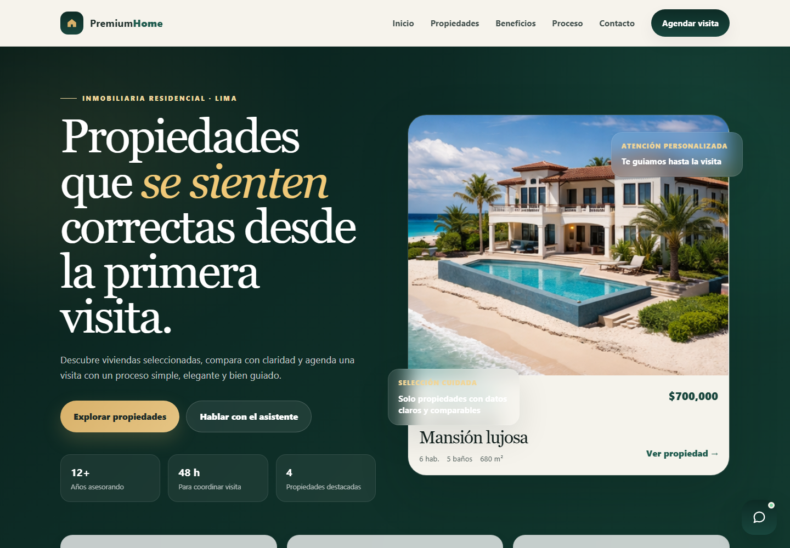

# Premium Home | Real Estate Showcase

[Español](#espanol) · [English](#english)

[Demo](https://premiumhome-iota.vercel.app) · [GitHub](https://github.com/Jp3528/premium_home)



<a id="espanol"></a>

## Español

### Descripción

Sitio inmobiliario estático orientado a presentar propiedades mediante una identidad visual de estilo premium. El proyecto combina maquetación adaptable, recursos locales e interacciones JavaScript con un asistente de demostración.

### Funcionalidades

- Presentación de marca y secciones comerciales inmobiliarias.
- Galería con recursos gráficos locales.
- Diseño adaptable a escritorio y móvil.
- Asistente frontend para explorar consultas de demostración.

### Tecnologías

HTML5 · CSS3 · JavaScript

### Ejecutar localmente

**Requisitos:** Python 3 o un servidor estático equivalente y un navegador moderno.

```bash
git clone https://github.com/Jp3528/premium_home.git
cd premium_home
```

```bash
python -m http.server 3000 --bind 127.0.0.1
```

Abre `http://127.0.0.1:3000`. No requiere instalar paquetes de aplicación.

### Estructura

| Ruta                       | Contenido                                  |
| -------------------------- | ------------------------------------------ |
| [`index.html`](index.html) | Estructura de la experiencia.              |
| [`styles.css`](styles.css) | Diseño visual y responsive.                |
| [`chat.js`](chat.js)       | Asistente e interacciones de demostración. |
| [`img/`](img/)             | Recursos visuales locales.                 |

### Alcance

Proyecto frontend sin backend ni base de datos. Las consultas y formularios forman parte de la demostración visual y no acreditan confirmaciones de contacto, reservas reales ni conexión con servicios externos de IA.

---

<a id="english"></a>

## English

### Overview

A static real estate website presenting properties through a premium visual identity. The project combines responsive layouts, local assets and JavaScript interactions with a demonstration assistant.

### Features

- Brand presentation and real estate marketing sections.
- Gallery using local visual assets.
- Layouts adapted to desktop and mobile.
- Frontend assistant for exploring demonstration queries.

### Technology

HTML5 · CSS3 · JavaScript

### Run locally

**Requirements:** Python 3 or an equivalent static server and a modern browser.

```bash
git clone https://github.com/Jp3528/premium_home.git
cd premium_home
```

```bash
python -m http.server 3000 --bind 127.0.0.1
```

Open `http://127.0.0.1:3000`. No application package installation is required.

### Structure

| Path                       | Contents                                  |
| -------------------------- | ----------------------------------------- |
| [`index.html`](index.html) | Experience markup.                        |
| [`styles.css`](styles.css) | Visual and responsive styling.            |
| [`chat.js`](chat.js)       | Assistant and demonstration interactions. |
| [`img/`](img/)             | Local visual assets.                      |

### Scope

A frontend project without a backend or database. Queries and forms are part of the visual demonstration and do not establish contact confirmations, real reservations or external AI service integration.
