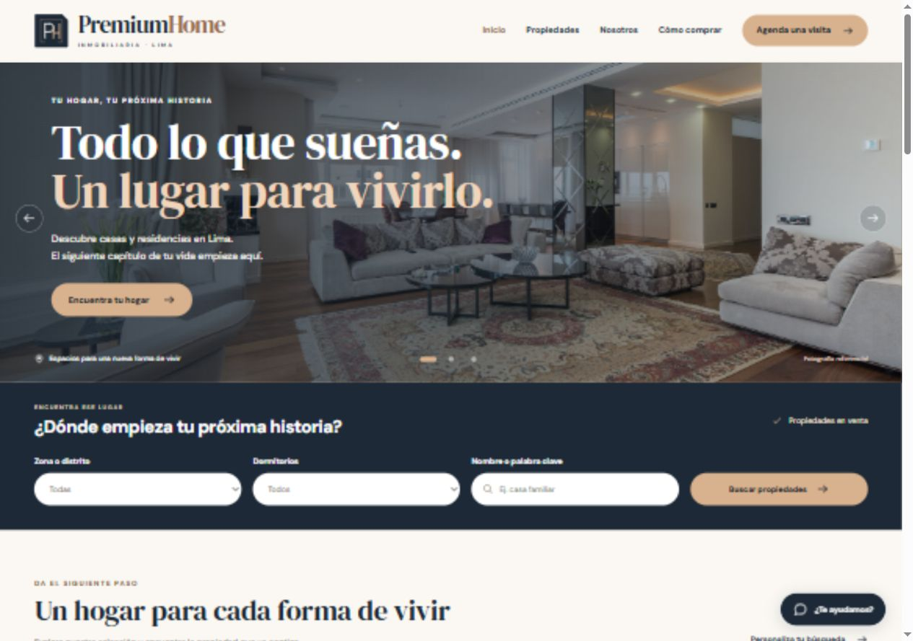

# Premium Home | Real Estate Showcase

[Español](#espanol) · [English](#english)

[Demo](https://premiumhome-iota.vercel.app) · [GitHub](https://github.com/Jp3528/premium_home)



<a id="espanol"></a>

## Español

### Descripción

Sitio inmobiliario estático orientado a presentar propiedades mediante una identidad visual de estilo premium. El proyecto combina maquetación adaptable, recursos locales e interacciones JavaScript con un asistente de demostración.

### Funcionalidades

- Presentación de marca y secciones comerciales inmobiliarias.
- Galería con recursos gráficos locales.
- Diseño adaptable a escritorio y móvil.
- Asistente frontend para explorar consultas de demostración.

### Tecnologías

HTML5 · CSS3 · JavaScript

### Ejecutar localmente

**Requisitos:** Node.js 20 o superior y un navegador moderno. No requiere instalar dependencias.

```bash
git clone https://github.com/Jp3528/premium_home.git
cd premium_home
```

```bash
npm start
```

Abre `http://127.0.0.1:3050`. El servidor solo escucha en este equipo. Para usar otro puerto, define la variable `PORT` antes de iniciarlo.

La versión local sigue una composición inmobiliaria inspirada en Abril y RE/MAX Perú: portada fotográfica panorámica con navegación manual, buscador destacado, tarjetas de propiedades y accesos por ubicación. Incorpora fotografías reales de referencia, tipografía local, ordenación y favoritos guardados en este navegador. El formulario y el asistente siguen siendo demostraciones locales.

Las fuentes y las fotografías se sirven desde el proyecto, sin depender de servicios externos al navegar. Consulta los [créditos de las fotografías](docs/image-credits.md).

La identidad propia combina azul noche, cobre y marfil, con DM Serif Display para los titulares y DM Sans para la interfaz. El [monograma PH en SVG](img/brand/premiumhome-symbol.svg) se utiliza en cabecera y pie; el favicon conserva la misma identidad.

### Estructura

| Ruta                       | Contenido                                  |
| -------------------------- | ------------------------------------------ |
| [`index.html`](index.html) | Estructura de la experiencia.              |
| [`styles.css`](styles.css) | Diseño visual y responsive.                |
| [`chat.js`](chat.js)       | Asistente e interacciones de demostración. |
| [`design.js`](design.js)   | Ordenación, favoritos y navegación.        |
| [`server.mjs`](server.mjs) | Servidor local sin dependencias.           |
| [`img/`](img/)             | Recursos visuales locales.                 |

### Alcance

Proyecto frontend sin backend ni base de datos. Las consultas y formularios forman parte de la demostración visual y no acreditan confirmaciones de contacto, reservas reales ni conexión con servicios externos de IA.

---

<a id="english"></a>

## English

### Overview

A static real estate website presenting properties through a premium visual identity. The project combines responsive layouts, local assets and JavaScript interactions with a demonstration assistant.

### Features

- Brand presentation and real estate marketing sections.
- Gallery using local visual assets.
- Layouts adapted to desktop and mobile.
- Frontend assistant for exploring demonstration queries.

### Technology

HTML5 · CSS3 · JavaScript

### Run locally

**Requirements:** Node.js 20 or later and a modern browser. No dependency installation is required.

```bash
git clone https://github.com/Jp3528/premium_home.git
cd premium_home
```

```bash
npm start
```

Open `http://127.0.0.1:3050`. The preview server listens on the local computer only. Set `PORT` to use a different port.

### Structure

| Path                       | Contents                                  |
| -------------------------- | ----------------------------------------- |
| [`index.html`](index.html) | Experience markup.                        |
| [`styles.css`](styles.css) | Visual and responsive styling.            |
| [`chat.js`](chat.js)       | Assistant and demonstration interactions. |
| [`img/`](img/)             | Local visual assets.                      |

### Scope

A frontend project without a backend or database. Queries and forms are part of the visual demonstration and do not establish contact confirmations, real reservations or external AI service integration.
